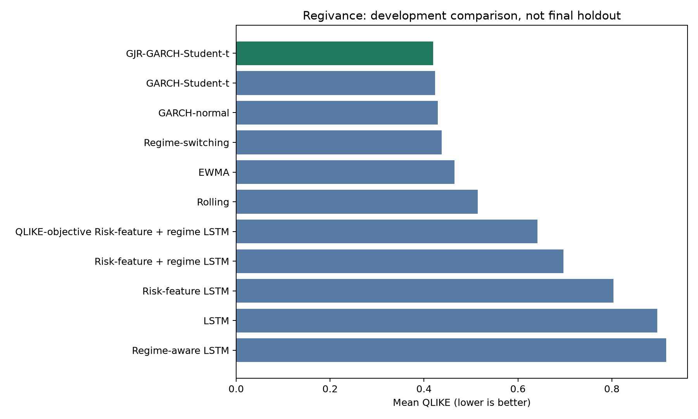

# Regivance

**Market-regime-aware portfolio volatility forecasting and reproducible research.**

Regivance investigates whether market-regime information improves five-observation portfolio-volatility forecasts beyond established statistical models. It combines a Python research engine with an interactive React dashboard for exploring methods and development results.

Built for academic research, internship demonstrations and portfolio presentation, the repository includes data processing, chronological evaluation, statistical and neural models, diagnostic reports, and a registered prospective evaluation protocol.

[Research report](reports/research_report.md) · [V2 assessment](docs/v2-assessment.md) · [Model scores](reports/tables/research_all_model_metrics.csv) · [Dashboard guide](website/README.md) · [Data contract](docs/data-contract.md) · [Implementation status](docs/implementation-plan.md)

## Contents

1. [Project overview](#project-overview)
2. [Current delivery status](#current-delivery-status)
3. [Architecture](#architecture)
4. [Technology stack](#technology-stack)
5. [Repository structure](#repository-structure)
6. [Prerequisites](#prerequisites)
7. [Quick start: dashboard demonstration](#quick-start-dashboard-demonstration)
8. [Research environment setup](#research-environment-setup)
9. [Dataset and provenance](#dataset-and-provenance)
10. [Portfolio and forecasting target](#portfolio-and-forecasting-target)
11. [Features and market regimes](#features-and-market-regimes)
12. [Forecasting models](#forecasting-models)
13. [Walk-forward evaluation](#walk-forward-evaluation)
14. [Metrics and statistical uncertainty](#metrics-and-statistical-uncertainty)
15. [Reproduced development results](#reproduced-development-results)
16. [V2 evidence extensions](#v2-evidence-extensions)
17. [Running the research workflow](#running-the-research-workflow)
18. [Configuration and reproducibility](#configuration-and-reproducibility)
19. [Dashboard features and data integration](#dashboard-features-and-data-integration)
20. [Testing and quality checks](#testing-and-quality-checks)
21. [Reports and generated artifacts](#reports-and-generated-artifacts)
22. [Prospective final evaluation](#prospective-final-evaluation)
23. [Deployment and scaling](#deployment-and-scaling)
24. [Troubleshooting](#troubleshooting)
25. [Development workflow](#development-workflow)
26. [Limitations and future work](#limitations-and-future-work)
27. [Data attribution and licensing](#data-attribution-and-licensing)

## Project overview

The central research question is:

> Does market-regime information improve five-observation portfolio-volatility forecasts beyond strong statistical alternatives under chronological evaluation?

The project compares simple volatility baselines, GARCH variants, regime-dependent model selection, and LSTM variants on the same forecast dates. It assesses both forecast accuracy and the uncertainty surrounding differences between models.

The current result is informative: Student-t GJR-GARCH achieves the lowest pooled development errors. Regime inputs improve some neural comparisons, but the evidence does not support a general claim that adding regimes or neural networks produces better forecasts.

### Main capabilities

- Parse and validate historical returns for 30 US industries.
- Construct an equal-industry portfolio and forward volatility target.
- Engineer trailing volatility, correlation and dispersion features.
- Discover training-window market regimes using standardized K-means.
- Compare 11 forecasting specifications on identical chronological dates.
- Measure pooled, fold-level and regime-conditional performance.
- Examine dependence, uncertainty, shock sensitivity and failure concentration.
- Reproduce experiments with recorded configuration, environment and artifact fingerprints.
- Present results through a responsive React interface with light/dark themes and interactive controls.

## Current delivery status

Verification baseline: **October 15, 2026**.

| Deliverable | Status |
| --- | --- |
| Python data, feature and forecasting implementation | Implemented |
| Full development comparison | Completed: 120 folds, 2,520 origins per model |
| Regime and neural experiments | Implemented and evaluated |
| Diagnostics, robustness tables and development report | Generated |
| V2 shock, rapid-rise, VaR, seed and portfolio analyses | Implemented and reproduced on the development sample |
| React dashboard | Implemented; production build verified |
| Local Python tests | 121 passing |
| Local React tests | 3 passing |
| Python dependency consistency | Verified with `pip check` |
| Automated CI configuration | Python tests on Windows/Linux plus React tests/build; runs on pushes and pull requests |
| Prospective evaluation implementation | Implemented, registered and tested on synthetic data |
| Prospective real-market evidence | Awaiting future observations |

The application is suitable for a local project demonstration. Research conclusions currently describe the development study. Prospective validation, production operations, and large-scale service performance are separate milestones.

## Architecture

The Python engine and browser interface have separate responsibilities:

| Layer | Responsibility | Location |
| --- | --- | --- |
| Source data | Archived industry-return file and provenance | `data/raw/` |
| Research engine | Parsing, portfolio construction, features and forecasts | `src/` |
| Experiment execution | Ordered comparison and reporting commands | `scripts/` |
| Research evidence | Metrics, diagnostics, figures and reports | `reports/` |
| Presentation | Routes, charts, filters, animation and themes | `website/` |
| Validation | Unit/integration tests and CI | `tests/`, `website/src/App.test.jsx`, `.github/` |

The research flow is:

```text
Archived source returns
    -> validated portfolio and forward targets
    -> chronological folds and training-only transformations
    -> statistical, regime and neural forecasts
    -> aligned metrics, uncertainty estimates and reports
    -> reviewed summary values used by the dashboard
```

The dashboard currently reads a curated JavaScript data module. There is no live Python API or automatic CSV-to-browser synchronization. Browser requests do not launch model training.

## Technology stack

| Area | Technologies | Purpose |
| --- | --- | --- |
| Data processing | Python, NumPy, pandas, PyArrow | Parsing, numerical operations and data support |
| Statistical forecasting | arch | GARCH and GJR-GARCH variants |
| Regime discovery | scikit-learn | Scaling and K-means |
| Neural forecasting | PyTorch | LSTM training and prediction |
| Statistical analysis | SciPy, statsmodels | Supporting statistical calculations and HAC inference |
| Research graphics | Matplotlib | Saved diagnostic and comparison figures |
| Configuration | PyYAML | Validated experiment settings |
| Web application | React, Vite, React Router | UI, build tooling and navigation |
| Interaction | Framer Motion, Recharts, Lucide | Animation, charts and icons |
| Testing | pytest, Vitest, Testing Library | Python and React verification |

Python dependency ranges are in [requirements.txt](requirements.txt). The research environment snapshot is in [requirements-lock-windows-py313.txt](requirements-lock-windows-py313.txt). Web dependency versions are resolved in [website/package-lock.json](website/package-lock.json); use `npm ci` for reproducible installation.

## Repository structure

```text
Regivance/
├── .github/workflows/tests.yml       Python CI configuration
├── configs/
│   ├── research.yaml                Active research configuration
│   ├── frozen_protocol.json         Registered prospective specification
│   └── experiment.yaml              Historical scaffold; unused by current runner
├── data/
│   ├── raw/                         Local source data and provenance README
│   └── processed/                   Generated portfolio and forecast datasets
├── docs/
│   ├── data-contract.md             Input, target and timing rules
│   ├── implementation-plan.md       Delivery status and remaining milestones
│   ├── completion-summary.md        Research implementation change summary
│   └── v2-assessment.md             Review decisions and V2 evidence scope
├── src/
│   ├── data/
│   │   ├── loader.py                Source-table parsing
│   │   └── portfolio.py             Portfolio and forward target construction
│   ├── features/
│   │   ├── rolling_features.py      Volatility, correlation and dispersion
│   │   └── regimes.py               Training-fitted market regimes
│   ├── models/
│   │   ├── rolling_volatility.py
│   │   ├── ewma.py
│   │   ├── garch.py
│   │   ├── lstm.py
│   │   └── lstm_data.py              Sequence construction
│   ├── evaluation/
│   │   ├── splits.py                Chronological fold boundaries
│   │   ├── metrics.py               Loss functions and pooled scores
│   │   ├── regime_analysis.py       Fold-level regime analysis
│   │   └── final_protocol.py        Prospective eligibility and history hashing
│   └── research_config.py           Configuration loading and validation
├── scripts/                         Experiment, diagnostic and reporting commands
├── tests/                           Python unit and integration tests
├── reports/
│   ├── research_report.md           Consolidated development study
│   ├── figures/                     Research graphics
│   ├── tables/                      Forecast and metric artifacts
│   └── runs/                        Local logs, environment records and manifests
├── website/
│   ├── src/
│   │   ├── components/
│   │   │   ├── charts/              Reusable result visualization
│   │   │   ├── layout/              Navigation and application shell
│   │   │   └── ui/                  Theme, page intro and regime explorer
│   │   ├── data/research.js          Curated dashboard results
│   │   ├── pages/                   Five route-level views
│   │   ├── styles/                  Responsive styles and theme tokens
│   │   ├── test/                    Test environment setup
│   │   ├── App.jsx                  Lazy-loaded routes
│   │   ├── App.test.jsx              UI behavior tests
│   │   └── main.jsx                 Browser entry point
│   ├── package.json
│   ├── package-lock.json
│   └── vite.config.js
├── requirements.txt
├── requirements-lock-windows-py313.txt
└── README.md
```

Raw files, most generated predictions, run logs, virtual environments, web dependencies and build output are ignored by Git. Compact research summary tables and selected figures are retained.

## Prerequisites

| Requirement | Verified environment / guidance |
| --- | --- |
| Git | Required for cloning and branch operations |
| Python | 64-bit Python 3.13; research snapshot used 3.13.14 |
| Node.js | Web build verified with Node.js 24.21.0 |
| npm | Use the npm installation accompanying Node.js |
| Source dataset | Required for research reproduction; unnecessary for the static dashboard demo |
| Network access | Required for initial package installation and source download |

Research comparisons run on CPU with one PyTorch thread in the comparison scripts. A GPU is not required for the supplied workflow. Runtime depends on the machine and model settings; there is no guaranteed completion time.

## Quick start: dashboard demonstration

Clone the repository and install the locked web dependencies:

```powershell
git clone https://github.com/gayatripraharshitha/Regivance.git
cd Regivance
cd website
npm.cmd ci
npm.cmd run dev
```

Open the local URL printed by Vite, normally `http://localhost:5173`. Stop the server with `Ctrl+C`.

On Linux/macOS, use `npm` instead of `npm.cmd`. On Windows, `npm.cmd` avoids PowerShell restrictions on `npm.ps1`.

### Suggested demonstration sequence

1. Open **Overview** to introduce the research question and development finding.
2. Visit **Data & features** to explain the portfolio, target and three regime features.
3. Use the regime explorer to explain lower, middle and higher volatility ranks.
4. Visit **Results**, switch MAE/RMSE/QLIKE, filter model families and inspect individual models.
5. Open **Methodology** to explain the chronological folds and embargo.
6. Switch light/dark themes and show the report for deeper research evidence.

The dashboard includes curated scores, so this presentation path does not require downloading the source dataset or rerunning all experiments.

## Research environment setup

Run research commands from the repository root.

### Windows PowerShell

```powershell
py -3.13 -m venv .venv
.\.venv\Scripts\python.exe -m pip install --upgrade pip
.\.venv\Scripts\python.exe -m pip install -r requirements.txt
.\.venv\Scripts\python.exe -m pip check
```

Activation is optional because these commands explicitly use the virtual environment. To activate it:

```powershell
.\.venv\Scripts\Activate.ps1
python -c "import sys; print(sys.executable)"
```

If activation is blocked, continue using the explicit executable. A terminal-scoped alternative is `Set-ExecutionPolicy -Scope Process -ExecutionPolicy Bypass`, followed by activation.

### Linux/macOS

```bash
python3 -m venv .venv
.venv/bin/python -m pip install --upgrade pip
.venv/bin/python -m pip install -r requirements.txt
.venv/bin/python -m pip check
```

For the commands below, replace `.\.venv\Scripts\python.exe` with `.venv/bin/python` on these platforms.

### Exact research environment

To install the recorded Windows/Python 3.13 environment, use:

```powershell
.\.venv\Scripts\python.exe -m pip install -r requirements-lock-windows-py313.txt
```

This file is a snapshot of installed versions, rather than a cross-platform package archive with artifact hashes. Runtime/platform differences can affect floating-point results. The prospective evaluator applies stricter environment matching against its registration.

## Dataset and provenance

The input is the **daily 30 Industry Portfolios** dataset from the Kenneth R. French Data Library.

- [Source library](https://mba.tuck.dartmouth.edu/pages/faculty/ken.french/data_library.html)
- [Daily CSV ZIP download](https://mba.tuck.dartmouth.edu/pages/faculty/ken.french/ftp/30_Industry_Portfolios_Daily_CSV.zip)
- [Recorded local provenance](data/raw/README.md)

Download and extract the source CSV to:

```text
data/raw/30_Industry_Portfolios_Daily.csv
```

The inspected vintage contains **26,317 observations** across **30 industries**, from **1926-07-01 to 2026-08-31**. Its SHA-256 is:

```text
dd2ca61d3cfe66c279e347a91535e12520907ceb98808ca42fff05c0657dc924
```

The original retrieval date was not recorded. The vintage was inspected and reproduced on October 15, 2026. A newly downloaded file may include additional observations or revised history.

### Parsing and validation policy

- Read the source's **value-weighted daily table**.
- Convert source percentages to decimal simple returns.
- Preserve valid chronological source observations, including historical Saturdays.
- Surface missing-value sentinels; downstream builders reject missing/nonfinite inputs.
- Reject duplicate or unordered dates where required by downstream processing.
- Preserve the source-confirmed Services return of 111.85% on 1931-01-29 as `1.1185`; no automatic clipping is applied.
- Keep an unmodified copy of the original vintage before acquiring updates.

Validate the file:

```powershell
.\.venv\Scripts\python.exe -B scripts/validate_data.py
```

See the [data contract](docs/data-contract.md) for component-level timing and validation rules.

## Portfolio and forecasting target

The source's industry returns are value-weighted **within industries**. Regivance then assigns equal daily weights **across the 30 industries**:

```text
r_portfolio[t] = (1 / 30) × sum(r_industry[i, t], i = 1,...,30)

target_volatility_5d[t] =
    sqrt(sum(r_portfolio[t+j]², j = 1,...,5))
```

The portfolio construction implies daily rebalancing across industries. Forecasts are made after the close of observation `t`, using information available through that observation.

The target is the root sum of the next five squared portfolio returns. It is not annualized and does not subtract a sample mean. The last five source observations lack complete forward labels and are excluded from the forecasting dataset.

Observation counts follow source trading records rather than calendar-day offsets.

## Features and market regimes

| Feature | Definition | Interpretation |
| --- | --- | --- |
| Portfolio volatility | Root mean square of the latest 21 portfolio returns | Recent amplitude of portfolio movements |
| Mean industry correlation | Average correlation across 435 distinct industry pairs over 21 observations | How strongly industries move together |
| Cross-sectional dispersion | Population standard deviation across 30 same-day industry returns | How widely industry outcomes differ |

The first 20 rolling-feature observations remain missing. Undefined correlations also remain missing; they are not replaced with arbitrary values.

Within each fold, a scaler and three-cluster K-means model are fitted only on complete training features. Clusters are then ranked **lower**, **middle** and **higher** by their training-center portfolio volatility.

These are relative ranks within a training window. Cluster identifiers and economic meaning can change across windows; a higher-volatility cluster is not a guaranteed crisis label.

## Forecasting models

| Model | Inputs / approach | Role |
| --- | --- | --- |
| Rolling | 21-observation RMS scaled to a five-observation horizon | Simple baseline |
| EWMA | Exponentially weighted variance, decay 0.94 | Adaptive baseline |
| GARCH-normal | GARCH(1,1), normal innovations | Statistical benchmark |
| GARCH-Student-t | GARCH(1,1), Student-t innovations | Heavy-tail benchmark |
| GJR-GARCH-Student-t | Asymmetric GARCH, Student-t innovations | Asymmetric benchmark |
| Regime-switching | Validation-selected statistical model by regime | Regime-dependent model selection |
| LSTM | 30 industry-return sequences | Neural baseline |
| Regime-aware LSTM | Returns plus three regime indicators | Discrete regime context |
| Risk-feature LSTM | Returns plus three continuous risk features | Continuous market context |
| Risk-feature + regime LSTM | Returns, risk features and regime indicators | Combined context |
| QLIKE-objective risk + regime LSTM | Combined context trained using QLIKE | Controlled objective comparison |

The regime-switching model chooses among the five statistical forecasts using validation QLIKE. If a regime has fewer than 20 validation observations, it uses the global validation winner.

### Neural specification

| Setting | Value |
| --- | --- |
| Sequence lookback | 21 observations |
| Recurrent layers / hidden size | 1 / 12 |
| Dropout | 0 |
| Batch size | 128 |
| Maximum epochs | 12 |
| Early-stopping patience | Up to 4 epochs |
| Learning rate / weight decay | 0.001 / 0.00001 |
| Seed | 42 + fold number |
| Primary objective | MSE on training-standardized log volatility |
| Additional objective | QLIKE |

Input and target transformations are fitted on training data. Early stopping uses validation performance. These are fixed compact research specifications; exhaustive hyperparameter optimization and repeated-seed evaluation are not included.

## Walk-forward evaluation

Each rolling fold uses:

```text
1,260 training origins
    -> 5-observation gap
    -> 252 validation origins
    -> 5-observation gap
    -> 21 test origins
```

Folds advance by 21 observations. The reproduced development evaluation contains **120 folds** and **2,520 forecasts per model**, covering **2016-08-15 through 2026-08-24**.

### Leakage safeguards

- Forward targets span `t+1` through `t+5`; gaps keep training/validation/test labels separated.
- Scalers and clustering use permitted training data only.
- Validation observations control early stopping and model selection.
- Test predictions and actual targets must share identical dates.
- GARCH parameters are fitted on training data; subsequently observed returns update the variance state.
- Later folds may use earlier test observations after those observations become historical.

The chronological predictions are out of sample relative to their fitting windows. The entire development period has nevertheless informed research decisions, so it is not an untouched confirmatory holdout. The legacy splitter argument named `final_test_size` does not change that distinction.

## Metrics and statistical uncertainty

For actual volatility `y` and predicted volatility `ŷ`:

| Metric | Definition | Interpretation |
| --- | --- | --- |
| MAE | `mean(abs(y - ŷ))` | Average absolute volatility error |
| RMSE | `sqrt(mean((y - ŷ)²))` | Larger errors receive greater weight |
| QLIKE | `mean(z - log(z) - 1)`, where `z = y² / ŷ²` | Variance-ratio forecasting loss |

Lower values are better. MAE/RMSE use decimal five-observation volatility units; QLIKE uses the squared volatility quantities.

The analysis accounts for overlapping targets and temporal dependence through:

- Newey-West HAC comparisons with lag choices 4, 10 and 20.
- Holm adjustments for the stated comparison families.
- Moving-block bootstrap intervals with 2,000 resamples.
- Block lengths 5 and 21 in the matched neural analysis; length 21 in the consolidated QLIKE comparison.
- Descriptive comparisons across years, regimes, five nonoverlapping-target offsets and the February–April 2020 shock period.

These uncertainty estimates remain exploratory because the period informed development. Non-significance is not evidence of equivalence, and statistical differences do not by themselves establish economic usefulness.

## Reproduced development results

All rows below use the same 2,520 evaluation origins. Values are rounded to six decimal places.

| Model | MAE | RMSE | QLIKE |
| --- | ---: | ---: | ---: |
| **GJR-GARCH-Student-t** | **0.007468** | **0.011129** | **0.419191** |
| GARCH-Student-t | 0.007828 | 0.011590 | 0.423978 |
| GARCH-normal | 0.007779 | 0.011505 | 0.429227 |
| Regime-switching | 0.007537 | 0.011246 | 0.437712 |
| EWMA | 0.008098 | 0.012693 | 0.465240 |
| Rolling | 0.008193 | 0.013208 | 0.514782 |
| QLIKE-objective risk + regime LSTM | 0.008328 | 0.014348 | 0.641875 |
| Risk-feature + regime LSTM | 0.007499 | 0.014195 | 0.697074 |
| Risk-feature LSTM | 0.007652 | 0.014686 | 0.803322 |
| LSTM | 0.008189 | 0.015012 | 0.896497 |
| Regime-aware LSTM | 0.007932 | 0.015043 | 0.915365 |



Student-t GJR-GARCH has the best pooled score across all three metrics. Adding regimes helps some neural comparisons, but does not establish general superiority over the statistical alternatives. Training the combined neural model with QLIKE improves its QLIKE relative to log-MSE training while still trailing GJR-GARCH.

For full precision and interpretation, consult the [metric table](reports/tables/research_all_model_metrics.csv), [paired QLIKE comparisons](reports/tables/research_qlike_comparisons.csv), [dependence analysis](reports/dependence_robust_comparison.md) and [research report](reports/research_report.md).

## V2 evidence extensions

V2 adds the evidence requested by a quantitative-risk review. These analyses were chosen after inspecting the development results, so they strengthen diagnosis and presentation without becoming new confirmatory evidence.

### Stress-period comparison

The groups below are mutually exclusive: the 2020 shock is February–April 2020; high volatility is the fold-relative higher regime outside that interval; normal combines the lower and middle regimes outside the shock.

| Period | Origins | GJR-GARCH-t QLIKE | Risk + regime LSTM QLIKE | LSTM underprediction rate |
| --- | ---: | ---: | ---: | ---: |
| Normal | 2,242 | 0.4030 | 0.4869 | 49.4% |
| High volatility | 216 | 0.4034 | 0.7486 | 71.3% |
| February–April 2020 | 62 | 1.0605 | 8.1162 | 88.7% |

The LSTM's weakness is concentrated where risk management matters most. In the most extreme 5% of target-volatility increases, both models underpredict frequently, while the LSTM records the larger QLIKE: 3.0528 versus 1.9791.

### Practical-risk and sensitivity checks

- A zero-mean Normal five-observation VaR demonstration compares forecast volatility with the next five summed portfolio returns. GJR-GARCH is close to nominal 95% coverage (4.96% breaches) but undercovers at 99% (2.50% breaches). The LSTM breaches 7.02% and 3.77%, respectively.
- Five LSTM seed bases on eight fixed folds produce QLIKE from 2.5192 to 3.4639, demonstrating material initialization sensitivity on the stress-inclusive subset.
- A lagged 63-observation inverse-volatility industry portfolio provides an additional construction. Student-t GJR-GARCH remains strongest among the three rerun benchmarks, with QLIKE 0.4457.
- The dashboard model metrics and stress table are exported from verified CSV artifacts by `scripts/export_dashboard_data.py` instead of being manually copied.

Reproduce these extensions after the main development artifacts exist:

```powershell
.\.venv\Scripts\python.exe -B scripts/run_v2.py
cd website
npm.cmd test
npm.cmd run build
```

Read [V2 risk analysis](reports/v2_risk_analysis.md) and [V2 seed sensitivity](reports/v2_lstm_seed_sensitivity.md) for definitions and limitations.

## Running the research workflow

After installing dependencies and placing the source file, run:

```powershell
.\.venv\Scripts\python.exe -B scripts/validate_data.py
.\.venv\Scripts\python.exe -B scripts/run_research.py
```

The runner executes these stages in order:

| Stage | Command file | Main output |
| --- | --- | --- |
| 1 | `build_dataset.py` | Portfolio returns and forward targets |
| 2 | `compare_statistical_models.py` | Five statistical model comparisons |
| 3 | `analyze_regime_performance.py` | Regime assignments and conditional metrics |
| 4 | `evaluate_regime_switching_model.py` | Validation-selected regime forecasts |
| 5 | `compare_lstm_risk_features.py` | Four neural input variants |
| 6 | `compare_lstm_qlike_objective.py` | Full 120-fold objective comparison |
| 7 | `generate_research_diagnostics.py` | Alignment checks and diagnostic figures |
| 8 | `analyze_forecast_failures.py` | Error concentration and failure attribution |
| 9 | `analyze_dependence_robust_comparison.py` | Matched loss tests and bootstrap intervals |
| 10 | `analyze_statistical_model_significance.py` | Statistical benchmark comparisons |
| 11 | `build_research_report.py` | Combined 11-model report and robustness tables |

A successful run ends with `Development reproduction complete.` Detailed stage output is written to `reports/runs/development/`.

### Resume and rerun behavior

```powershell
.\.venv\Scripts\python.exe -B scripts/run_research.py --resume
```

Resume reuses a successful stage only when its artifact hashes match and the overall data, configuration, code and environment identity is unchanged.

A fresh full run refreshes generated artifacts. It archives previous run records and controlled QLIKE outputs under `reports/runs/development/archive/`. It does not provide a full immutable archive of every previous generated file; preserve any experiment bundle you need before rerunning.

Failed stages are recorded and stop execution. A partial run is not marked complete. Smaller neural runs using `--max-folds` are implementation checks, not substitutes for the complete comparison.

## Configuration and reproducibility

The active file is [configs/research.yaml](configs/research.yaml), validated by [src/research_config.py](src/research_config.py). The old `configs/experiment.yaml` is retained as historical scaffold and is not the active runner configuration.

| Configuration group | Important values |
| --- | --- |
| Data | Raw CSV path |
| Evaluation | Train 1,260; validation 252; test/step 21; development 2,520; horizon/gaps 5 |
| Features | Window 21; regimes 3; seed 42 |
| Models | Rolling 21; EWMA 0.94; lookback 21; hidden 12; epochs 12; batch 128 |
| Regime selection | Minimum 20 validation observations per regime |
| Prospective evaluation | Freeze date 2026-10-15; 252 origins; QLIKE against Student-t GJR-GARCH |

To select a configuration for the runner:

```powershell
.\.venv\Scripts\python.exe -B scripts/run_research.py --config configs/research.yaml
```

The runner passes the selected file to its subprocesses. Direct scripts can use the `REGIVANCE_CONFIG` environment variable. Schema-encoded settings are intentionally constrained, and the development diagnostic suite requires 120 blocks of 21 observations. This is not an unrestricted experiment-search interface.

The manifest records source-data hashes, code/config fingerprints, Python/package versions, the Git commit, stage commands, return codes and generated artifact hashes. Consult those fingerprints when the working copy differs from its recorded commit.

## Dashboard features and data integration

| Page | Purpose |
| --- | --- |
| Overview | Research question, development summary and delivery status |
| Data & features | Portfolio construction, risk features and interactive regime explanations |
| Results | MAE/RMSE/QLIKE switching, family filters, search and model details |
| Methodology | Chronological research workflow and fold layout |
| About | Project scope, next milestone and repository link |

The interface includes a white/blue default theme, a dark/green alternative, a persisted theme switch, responsive navigation, lazy-loaded routes, animated page entrances, hover states and scroll progress. Motion settings respect reduced-motion preferences.

### Updating displayed research results

The current browser data source is [website/src/data/research.js](website/src/data/research.js). The displayed model values are curated from the reproduced results and rounded for presentation.

After a new research experiment:

1. Verify the new report and common evaluation dates.
2. Update the corresponding curated web values and explanatory text.
3. Keep model names, units and sample sizes consistent with the report.
4. Run the React tests and production build.
5. Review the changed pages before publishing.

The versioned dashboard JSON is generated from verified compact CSV artifacts by `scripts/export_dashboard_data.py`. A read-only API for large forecast histories remains a future extension. The decorative signal on the overview is an illustration rather than a historical forecast series. The regime explorer explains ranking semantics rather than classifying a live market.

## Testing and quality checks

### Python

```powershell
.\.venv\Scripts\python.exe -B -m pytest tests -v -p no:cacheprovider
.\.venv\Scripts\python.exe -m pip check
```

The current suite contains 125 tests covering portfolio targets, rolling/EWMA/GARCH behavior, feature timing, clustering, chronological splits, metrics, neural sequences/models, diagnostic consistency, reporting, artifact preservation, prospective safeguards and V2 timing/category contracts.

### React

From `website/`:

```powershell
npm.cmd ci
npm.cmd test
npm.cmd run build
```

The three tests cover initial rendering, persisted theme switching, and combined model-filter/search/selection behavior. They do not constitute full cross-browser visual or end-to-end coverage. The results-view component test substitutes the chart component.

### Continuous integration

[.github/workflows/tests.yml](.github/workflows/tests.yml) runs Python tests on Windows and Linux with Python 3.13, plus React tests and the production web build on Node.js 24, for pushes and pull requests. The earlier remote workflow completed successfully; each V2 push triggers a new run whose status should be checked on GitHub.

## Reports and generated artifacts

| Artifact | Purpose |
| --- | --- |
| [Research report](reports/research_report.md) | Methods, results, uncertainty and limitations |
| [Preprocessing and diagnostics](reports/preprocessing_and_diagnostics.md) | Target/feature checks and forecast diagnostics |
| [Failure attribution](reports/forecast_failure_attribution.md) | Concentration of large forecast losses |
| [Dependence-robust analysis](reports/dependence_robust_comparison.md) | Matched neural comparisons and lag sensitivity |
| [All-model metrics](reports/tables/research_all_model_metrics.csv) | Full-precision pooled scores |
| [Robustness metrics](reports/tables/research_robustness_metrics.csv) | Year, regime, shock and target-offset checks |
| [QLIKE comparisons](reports/tables/research_qlike_comparisons.csv) | Paired loss tests against the reference model |
| [Report input hashes](reports/tables/research_report_inputs.json) | Input fingerprints for report generation |
| [V2 risk analysis](reports/v2_risk_analysis.md) | Stress, underprediction, VaR and alternative-portfolio evidence |
| [V2 seed sensitivity](reports/v2_lstm_seed_sensitivity.md) | Five-seed fixed-subset neural stability check |
| `data/processed/` | Local processed data and statistical predictions |
| `reports/tables/` | Additional generated predictions and comparison tables |
| `reports/runs/development/` | Local manifest, package snapshot and stage logs |
| `reports/final_evaluation/` | Future final-evaluation outputs, created only when eligible |

A fresh clone includes the committed report and compact evidence, but not all locally generated files. Run the research workflow to reconstruct those artifacts.

## Prospective final evaluation

The original registration is stored in [configs/frozen_protocol.json](configs/frozen_protocol.json). V2 uses `configs/frozen_protocol_v2.json` and narrows fingerprints to the actual prospective dependencies so unrelated reporting additions do not create false protocol drift. The [amendment](docs/protocol-amendment-v2.md) preserves the original and explains the change. Both record configuration, source fingerprints, historical-return identity and the research environment.

All currently available data is considered exposed. The prospective period begins **strictly after October 15, 2026** and requires the first **252 forecast origins plus five target-completion observations**: 257 new source observations.

Check readiness:

```powershell
.\.venv\Scripts\python.exe -B scripts/final_evaluation.py
```

For the current vintage, the expected status is `awaiting_future_data`.

When sufficient future observations exist, pass a separate updated source file:

```powershell
.\.venv\Scripts\python.exe -B scripts/final_evaluation.py --run --raw data/raw/30_Industry_Portfolios_Daily_updated.csv
```

The evaluator checks the frozen configuration, Python code, environment and historical parsed returns; selects the first eligible period; and runs the same 11 specifications. It refuses incomplete periods, protocol drift and replacement of existing final outputs.

The registration is already initialized. The one-time `--freeze` option refuses to replace it. If a source revision or necessary code change requires an amendment, preserve the original registration and document the change explicitly before creating a reviewed successor protocol. Do not edit fingerprints merely to suppress an error.

A dated repository registration provides provenance; it is not an external preregistration service. The final result depends on future trading observations and dataset availability, so there is no guaranteed calendar completion date.

## Deployment and scaling

### Build a deployable frontend

From `website/`:

```powershell
npm.cmd ci
npm.cmd run build
npm.cmd run preview
```

The production files are generated in `website/dist/`. The preview command is for checking that build locally.

The current React application uses `BrowserRouter`. A production host must serve `index.html` for application routes such as `/results`, while serving real assets normally. The present configuration targets a root-hosted application; deployment under a repository subpath requires reviewing both Vite's base path and router configuration. No hosting deployment is performed by these commands.

### Scaling roadmap

The modular structure provides a starting point for growth, but production scalability has not been load-tested.

| Extension | Purpose | Current state |
| --- | --- | --- |
| Versioned JSON export | Synchronize reviewed Python artifacts with the dashboard | Planned |
| Read-only Python API | Serve filtered forecast history and experiment metadata | Planned |
| Background job queue | Execute long experiments outside browser requests | Planned |
| Object storage and cache | Distribute large forecast artifacts efficiently | Planned |
| Frontend CI and browser automation | Validate build and interaction behavior continuously | Planned |
| Authentication and access controls | Support private multi-user research workspaces | Not implemented |
| Observability and deployment automation | Track reliability, failures and releases | Not implemented |

Raw source data, environment secrets and training workloads should stay outside the browser bundle.

## Troubleshooting

| Symptom | Likely explanation | Action |
| --- | --- | --- |
| `npm.ps1 cannot be loaded` | PowerShell execution policy | Use `npm.cmd` |
| Python packages install into the wrong environment | Wrong interpreter/pip pair | Invoke the virtual-environment Python with `-m pip` |
| No matching Python distribution | Interpreter/wheel mismatch or stale installer | Use tested 64-bit Python 3.13 and update pip |
| Source CSV not found | Missing extraction or incorrect path | Check `data/raw/` and `research.yaml` |
| Prediction file missing | Required prior stage has not run | Run the complete research workflow |
| `Cannot resume` identity mismatch | Code, configuration, source or environment changed | Preserve prior results and start a fresh full run |
| QLIKE script refuses existing outputs | Controlled outputs already exist | Use the full runner's archival workflow or preserve prior artifacts explicitly |
| Final evaluation reports protocol drift | Frozen inputs/environment no longer match | Restore the recorded environment or prepare a documented amendment |
| Tests fail creating temporary directories | OS or sandbox permissions | Use a writable local terminal/temp directory and rerun |
| Hosted route refresh returns 404 | Missing SPA route fallback | Configure the host to serve `index.html` for app routes |
| Dashboard values differ from a new report | Curated web data was not updated | Reconcile `website/src/data/research.js` with verified artifacts |

## Development workflow

The repository uses `main`, `sid` and `gp`. Keep a clean working tree before switching branches and review remote history before synchronization.

A typical contribution sequence is:

1. Fetch the latest remote state.
2. Work on the intended development branch.
3. Make focused code/documentation changes.
4. Run checks appropriate to those changes.
5. Review the diff for source data, secrets or generated bulk files.
6. Commit and push to the requested branch.
7. Integrate into `main` through a reviewed merge or fast-forward.
8. Synchronize other branches when requested, preserving unique commits.

Python changes can invalidate the prospective code fingerprint. A necessary research-protocol change therefore requires explicit amendment documentation. Presentation-only files are outside that Python source fingerprint.

## Limitations and future work

- Results use one equal-industry portfolio and one archived source vintage.
- Overlapping five-observation labels create serial dependence.
- The development period influenced modeling decisions.
- Cluster ranks may change between training windows.
- Neural specifications are compact and use one seed per fold.
- Bootstrap intervals condition on saved predictions and do not capture every source of model-selection uncertainty.
- Shock and subgroup analyses are descriptive, selected after inspecting development evidence.
- The project does not evaluate transaction costs, trading profitability, allocation utility or causal regime effects.
- The dashboard is a static research presentation, without live forecasts or automated report synchronization.
- Prospective market validation and production-scale performance remain unverified.

The next research milestone is the registered prospective comparison. The next product milestone is a versioned artifact export and broader frontend/browser validation.

## Data attribution and licensing

The industry-return source is the Kenneth R. French Data Library. Consult its source documentation and applicable terms before redistributing data. Raw source files are intentionally excluded from this repository.

No project license file is currently included. Public repository availability should not be interpreted as an explicit open-source license grant; clarify licensing with the repository owner before redistribution or commercial reuse.

Regivance is an educational and research project. Its displayed forecasts and findings are not investment advice.
